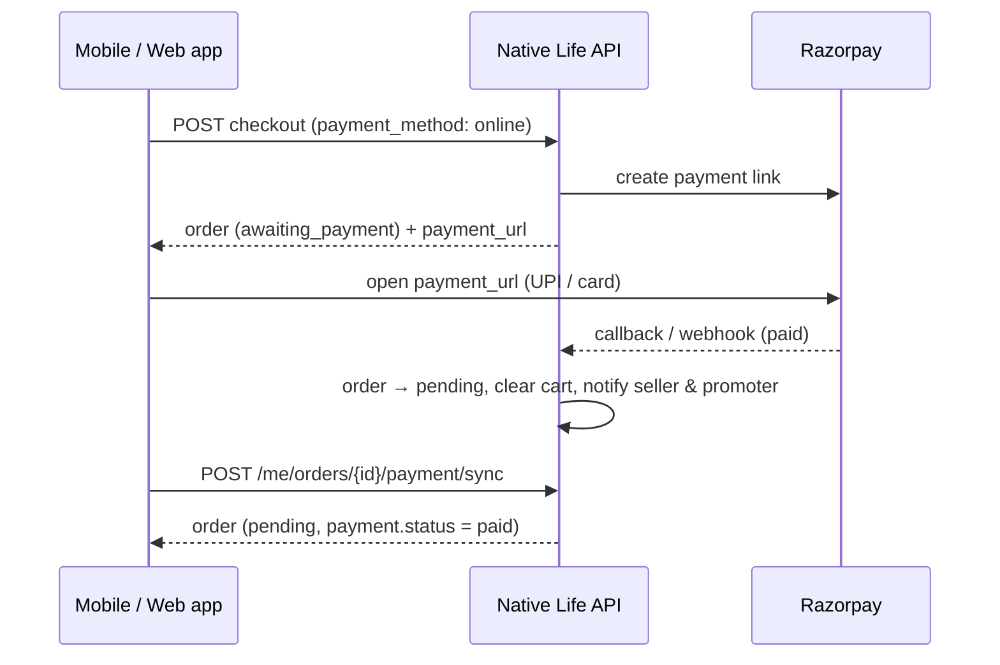
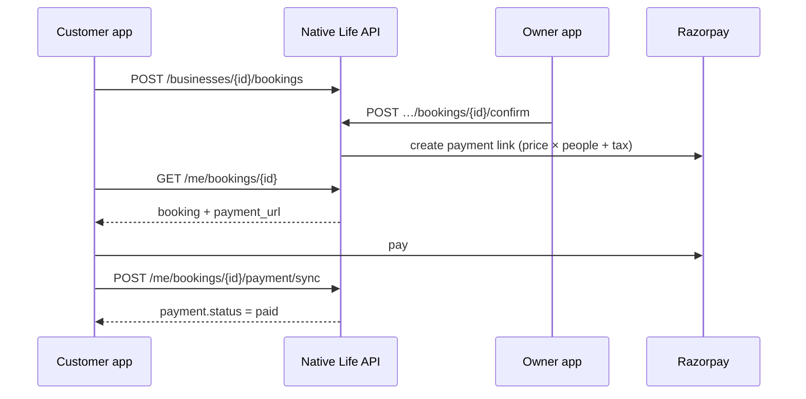

# Native Life Payments — Mobile & Web Integration

How the mobile app and the web app take online payments (UPI / Google Pay, cards, net banking,
wallets) through **Razorpay**. REST APIs are in [Swagger](/docs); real-time events are in the
[WebSocket API](/websocket-docs).

The apps never hold a Razorpay key and never talk to Razorpay's API. The server creates a
**payment link**, the app opens it, and the server confirms the result. Mobile and web call the
same endpoints and get the same `payment` object. Only the way the payment page is opened, and
the way the app comes back from it, differ.

## Quick Start

### Step 1 — Get a payment link

| Flow | When the link is created | Where it appears |
|---|---|---|
| **Orders** (products, deals) | At checkout with `"payment_method": "online"` | `data.payment` of the checkout response |
| **Bookings** (packages, services) | When the business owner confirms the booking | `payment` on `GET /api/v1/me/bookings/{booking_id}` |

### Step 2 — Open `payment.payment_url`

| Platform | How |
|---|---|
| Web | Redirect the page, or open a new tab |
| Mobile | In-app WebView, handing `upi://` / `intent://` links to the phone (see [Mobile app](#mobile-app)) |

The Razorpay page lists UPI apps (Google Pay, PhonePe, Paytm), shows a UPI QR code on desktop, and
accepts cards, net banking and wallets.

### Step 3 — Confirm with the server

When the customer comes back, call **sync** and use its response:

```text
POST /api/v1/me/orders/{order_id}/payment/sync
POST /api/v1/me/bookings/{booking_id}/payment/sync
```

`payment.status` is `paid` → show success. Never decide from what the payment page showed.

## The `payment` object

```json
{
  "id": "7d3f0a52-1c0e-4c6e-9a51-2f4f3b6f1a10",
  "provider": "razorpay",
  "status": "pending",
  "payment_url": "https://rzp.io/rzp/AbCdEf12",
  "total_amount": "573.95",
  "currency": "INR",
  "expires_at": "18-11-2026 03:06 PM",
  "paid_at": null
}
```

| Field | Meaning |
|---|---|
| `status` | `pending` (waiting), `paid`, `expired` (link timed out), `cancelled` |
| `payment_url` | The Razorpay page to open |
| `total_amount`, `currency` | Amount the customer pays (string decimal, e.g. `"573.95"`) |
| `expires_at` | After this the link can't be paid |
| `paid_at` | Set once paid, else `null` |

Order payments also carry `order_id`. Booking payments carry `booking_id` and the price breakdown
to show before paying:

```json
{
  "unit_price": "24000.00",
  "party_size": 2,
  "subtotal": "48000.00",
  "tax_percent": "18.00",
  "tax_amount": "8640.00",
  "total_amount": "56640.00"
}
```

> Dates and times follow the signed-in user's date/time format settings. The values above are
> examples.

## Orders (pay first, then the order is created)

### Checkout

Pick the payment method at checkout:

| `payment_method` | Behaviour |
|---|---|
| `cash_on_delivery` (default) | The order is placed at once (`status: "pending"`). There is no `payment`. |
| `online` | Returns an order with `status: "awaiting_payment"` and a `pending` payment. The customer pays now. |

Checkout endpoints, all with the same `payment_method` field:

| Endpoint | Creates |
|---|---|
| `POST /api/v1/me/cart/checkout` (`deal_id` in body) | One deal order |
| `POST /api/v1/me/cart/businesses/{business_id}/checkout` | One order for that shop |
| `POST /api/v1/me/cart/products/checkout` | One order **per shop** (array); each has its own `payment_url` |
| `POST /api/v1/deals/{deal_id}/orders` | One deal order |
| `POST /api/v1/businesses/{business_id}/orders` | One direct order |

Request:

```json
{
  "customer_name": "Asha Nair",
  "customer_phone": "+919876543210",
  "delivery_option": "route",
  "route_id": "2b9c…",
  "address_id": "e4838b27…",
  "payment_method": "online",
  "notes": "Ring the bell"
}
```

Response (`201`):

```json
{
  "success": true,
  "message": "Order placed from your cart",
  "data": {
    "id": "6f7bd0e3-8016-4f66-a35e-…",
    "order_number": "NL26002031",
    "status": "awaiting_payment",
    "payment_method": "online",
    "total_amount": "573.95",
    "currency": "INR",
    "items": ["…"],
    "payment": {
      "status": "pending",
      "payment_url": "https://rzp.io/rzp/AbCdEf12",
      "total_amount": "573.95",
      "currency": "INR",
      "expires_at": "18-11-2026 03:06 PM",
      "paid_at": null
    }
  }
}
```

### What `awaiting_payment` means

While the order waits for payment it **does not exist for anyone else**:

- It is not in `GET /api/v1/me/orders` or in the seller's order lists. The seller and the
  delivery promoter are not told about it.
- The stock is held for the customer.
- **The cart keeps its items.** Don't clear your local cart until payment succeeds.
- `GET /api/v1/me/orders/{order_id}` still returns it to its customer, so you can show the payment
  screen again.

| Outcome | Order becomes | Cart | Seller / promoter |
|---|---|---|---|
| Paid | `pending`, then it appears in My orders | Paid items removed | Notified |
| Link expired (30 min) or cancelled | `cancelled` and hidden; it "was never created" | Items still there, the customer can check out again | Never notified |

The seller confirms a paid order only for delivery tracking. A paid order can be shipped at once.



### Errors at checkout

| HTTP | `message` | What to do |
|---|---|---|
| 422 | `Online payment is not configured` | Online payment is off on this server. Offer cash on delivery |
| 502 | `The payment gateway could not be reached; try again` | No order was placed and the cart is unchanged. Let the user retry |
| 422 | (validation / stock / delivery messages) | Same as cash on delivery |

## Bookings (confirm first, then pay)

1. The customer requests a booking: `POST /api/v1/businesses/{business_id}/bookings` (status
   `requested`, no payment yet).
2. The owner confirms: `POST /api/v1/me/businesses/{business_id}/bookings/{booking_id}/confirm`.
   The booking becomes `confirmed` and gets a `payment` with the breakdown above.
3. The customer sees it on `GET /api/v1/me/bookings` or `GET /api/v1/me/bookings/{booking_id}`,
   then opens `payment_url` and pays.
4. Call `POST /api/v1/me/bookings/{booking_id}/payment/sync`. When `payment.status` is `paid`,
   show "Paid". The owner gets a "paid" notification.

A booking link stays valid for 24 hours. If it expires, the booking stays `confirmed` but unpaid,
and the owner may cancel it.



## Web app

1. Send the customer to `payment.payment_url`. A same-tab redirect is simplest:

```js
window.location.href = order.payment.payment_url;
```

2. The server owner sets `PAYMENT_WEB_RETURN_URL` to your result page, for example
   `https://app.example.com/payment-result`. After Razorpay, the server verifies the payment and
   redirects there with:

```text
https://app.example.com/payment-result?payment_subject=order&payment_subject_id=<uuid>&payment_status=paid
```

| Query param | Values |
|---|---|
| `payment_subject` | `order` or `booking` |
| `payment_subject_id` | The order id or booking id |
| `payment_status` | `paid`, `expired`, `cancelled`, `pending` |

3. On the result page, call sync and render from its response:

```js
const params = new URLSearchParams(location.search);
const subject = params.get("payment_subject");
const id = params.get("payment_subject_id");
const path = subject === "booking" ? `/me/bookings/${id}` : `/me/orders/${id}`;

const res = await fetch(`${API_BASE}${path}/payment/sync`, {
  method: "POST",
  headers: { Authorization: `Bearer ${accessToken}` },
});
const body = await res.json();
const paid = body.success && body.data.payment?.status === "paid";
history.replaceState(null, "", location.pathname);
```

4. If you opened a **new tab** instead, call sync when your tab gets focus again
   (`window.addEventListener("focus", …)`).

## Mobile app

### Open the payment page in a WebView

1. Load `payment.payment_url` in an in-app WebView.
2. **UPI apps:** the Razorpay page starts Google Pay, PhonePe, Paytm and others with `upi://…`
   (iOS and Android) or `intent://…` (Android) links. A WebView can't load these, so stop the
   navigation and open them with the operating system.
3. **Finished:** when the WebView navigates to a URL that starts with
   `<API_BASE>/payments/razorpay/callback`, payment is done. Close the WebView. You don't need to
   load that page.
4. Call sync and show the result from its response. Also call sync if the user closes the
   WebView, and whenever the app returns to the foreground on a payment screen.

### Flutter example (`webview_flutter` + `url_launcher`)

```dart
final callbackPrefix = '$apiBase/payments/razorpay/callback';

final controller = WebViewController()
  ..setJavaScriptMode(JavaScriptMode.unrestricted)
  ..setNavigationDelegate(NavigationDelegate(
    onNavigationRequest: (request) async {
      final uri = Uri.parse(request.url);
      if (request.url.startsWith(callbackPrefix)) {
        Navigator.of(context).pop(true);
        return NavigationDecision.prevent;
      }
      if (uri.scheme != 'http' && uri.scheme != 'https') {
        await launchUrl(uri, mode: LaunchMode.externalApplication);
        return NavigationDecision.prevent;
      }
      return NavigationDecision.navigate;
    },
  ))
  ..loadRequest(Uri.parse(payment.paymentUrl));

// after the WebView screen closes (paid or not):
final res = await api.post('/me/orders/${order.id}/payment/sync');
final paid = res.data['payment']?['status'] == 'paid';
```

### Platform setup

| Platform | Setting |
|---|---|
| Android | Starting `intent://` links: turn them into the app link (`upi://pay?...`) or start them with an Android intent (e.g. the `android_intent_plus` package). Add `<queries>` for UPI apps in `AndroidManifest.xml` (Android 11+). |
| iOS | Add the UPI schemes to `LSApplicationQueriesSchemes` in `Info.plist`: `upi`, `gpay`, `tez`, `phonepe`, `paytmmp`, `bhim`. |
| Both | Check again with sync on app resume. If the OS kills the WebView while a UPI app is open, sync still finds the payment. |

## Endpoint reference

| Method | Path | Auth | Purpose |
|---|---|---|---|
| POST | `/api/v1/me/orders/{order_id}/payment/sync` | Bearer | Check an order's payment with Razorpay; returns the order |
| POST | `/api/v1/me/bookings/{booking_id}/payment/sync` | Bearer | Check a booking's payment; returns the booking |
| GET | `/api/v1/me/orders/{order_id}` | Bearer | The order, including one still `awaiting_payment` |
| GET | `/api/v1/me/bookings/{booking_id}` | Bearer | The booking with its `payment` |
| GET | `/api/v1/payments/razorpay/callback` | none | **Razorpay → server only.** Verifies the signature, then sends JSON or the web redirect |
| POST | `/api/v1/payments/razorpay/webhook` | Razorpay signature | **Razorpay → server only** (`payment_link.paid/expired/cancelled`) |

The apps call only the first four. Sync is safe to call any number of times.

## Testing (test mode)

| Use | Value |
|---|---|
| Mobile number on the Razorpay page | Any, e.g. `9876543210` |
| UPI success / failure | `success@razorpay` / `failure@razorpay` |
| Card | `4111 1111 1111 1111`, any future expiry, any CVV; pick **Success** on the bank page |
| Net banking | Any bank, then **Success** |

Real Google Pay / UPI QR payments need live keys (`rzp_live_…`) on an activated Razorpay account.
In test mode the UPI app buttons don't open a real app.

## Server settings (`.env`, for backend / DevOps)

| Setting | Purpose |
|---|---|
| `PAYMENT_PROVIDER` | `razorpay` to enable, `disabled` to turn online payment off |
| `RAZORPAY_KEY_ID`, `RAZORPAY_KEY_SECRET` | Razorpay Dashboard → API keys (never in the apps) |
| `RAZORPAY_WEBHOOK_SECRET` | Secret of the Dashboard webhook for `/api/v1/payments/razorpay/webhook` |
| `PAYMENT_CALLBACK_URL` | Public URL of `/api/v1/payments/razorpay/callback` |
| `PAYMENT_WEB_RETURN_URL` | Optional: the web result page to redirect to after the callback |
| `PAYMENT_LINK_EXPIRE_MINUTES` | Booking link lifetime (default 1440) |
| `ORDER_PAYMENT_EXPIRE_MINUTES` | How long an unpaid online order holds stock (default 30) |
